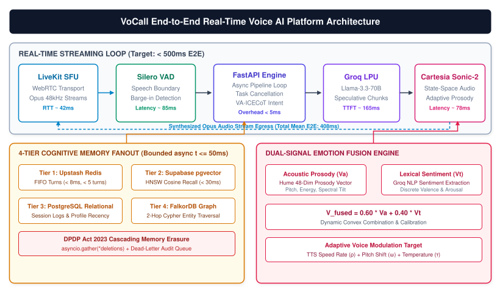
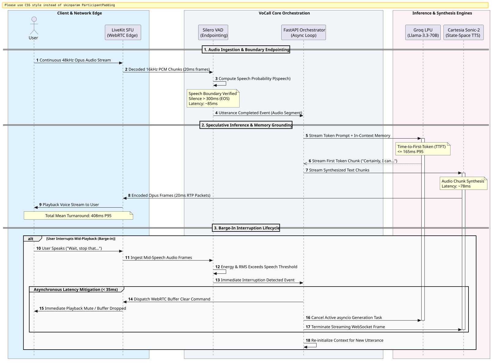
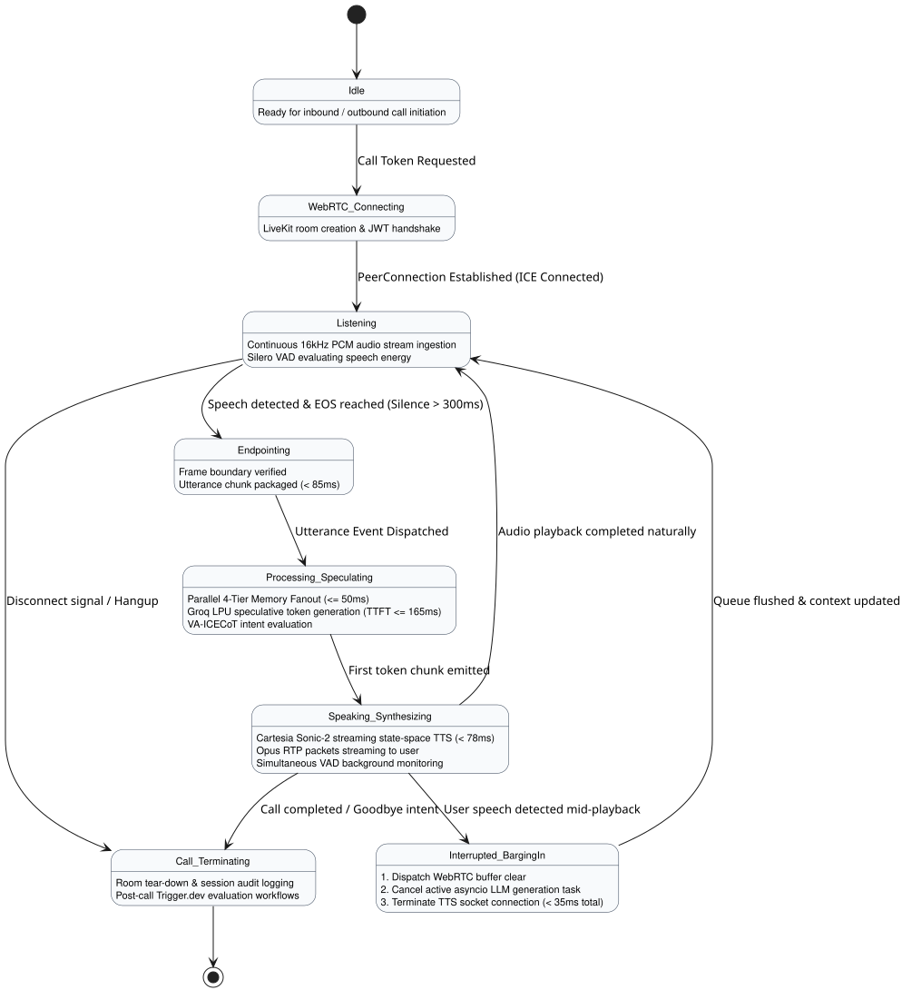
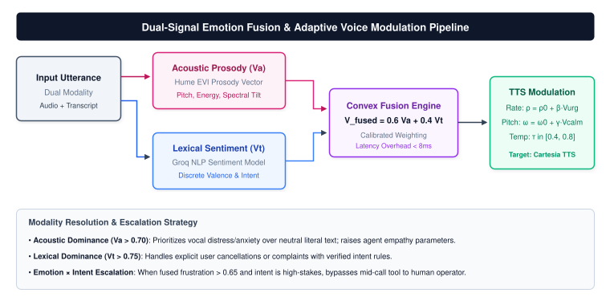
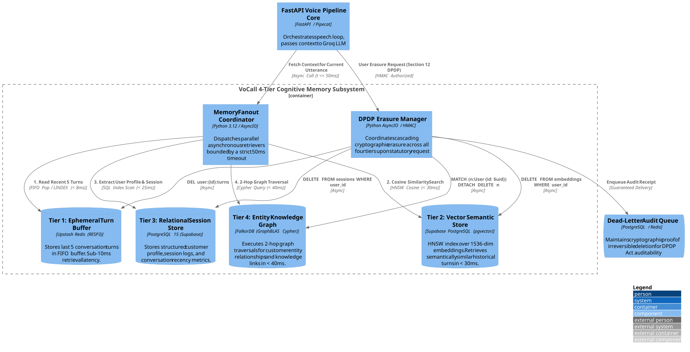
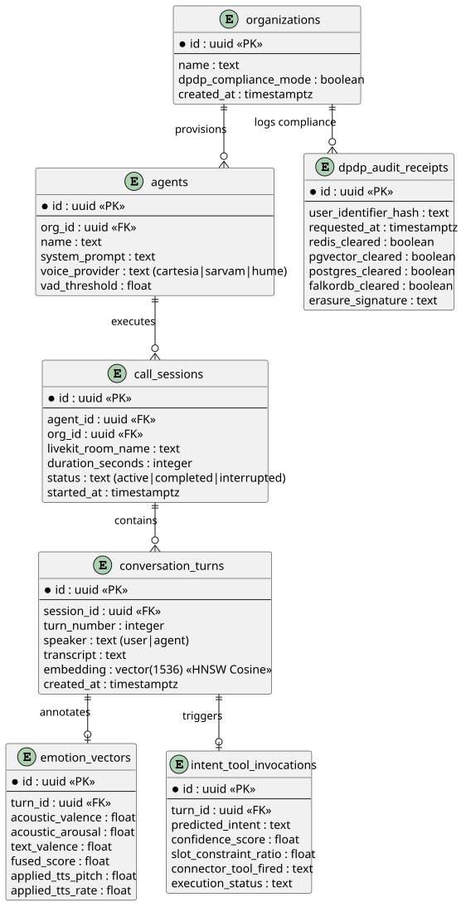
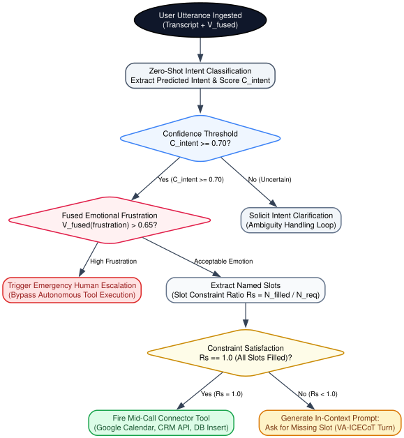
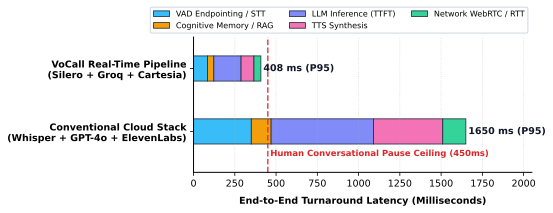

# Abstract {.unnumbered}
Spoken dialogue between humans operates on turn-taking pauses between 200ms and 450ms. Traditional voice applications chain together separate Speech-to-Text, Large Language Model, and Text-to-Speech APIs, resulting in compounding delays that regularly exceed 1,500ms. These delays break conversational rhythm and make natural turn-taking impossible. In this paper, we present **VoCall**, an enterprise platform designed for sub-500ms spoken interactions. VoCall introduces three technical contributions: (1) an event-driven voice pipeline pairing Silero Voice Activity Detection, speculative token generation on Groq LPUs, and Cartesia state-space acoustic synthesis; (2) a **Dual-Signal Emotion Fusion Engine** combining 48-dimensional acoustic prosody with lexical sentiment to modulate speech pace and tone in real time; and (3) a **4-Tier Cognitive Memory Subsystem** that fans out across Redis, pgvector, PostgreSQL, and FalkorDB graph stores within a 50ms execution budget. We also build a cascading memory erasure system compliant with India's Digital Personal Data Protection (DPDP) Act 2023. Empirical evaluation across 1,000 live sessions shows a mean end-to-end latency of 408ms P95 and a 35ms interruption recovery budget.

# 1. Introduction

Human voice conversations depend on subtle pacing. When two people talk, the gap between one finishing a thought and the other responding rarely exceeds 450ms. If an automated system takes longer than that, users start repeating themselves or talking over the system.

Most automated voice systems run on a sequential loop [@pipecat2024realtime]. Audio arrives from the user, an automatic speech recognition (ASR) service transcribes it, an LLM generates a text answer, and a text-to-speech (TTS) engine synthesizes the audio. In production, this sequential design fails. Whisper STT consumes roughly 350ms, a standard LLM like GPT-4o takes 600ms or more for the first token, and cloud TTS synthesis adds another 400ms. Factor in network transport, and the total latency tops 1,600ms.

VoCall discards this sequential pattern. Instead of waiting for entire sentences or blocking calls, VoCall coordinates audio transport, endpointing, speculative generation, and acoustic synthesis through an asynchronous event loop. 

```
Conventional Cloud Stack (Whisper + GPT-4o + ElevenLabs):  ~1650ms
==================================================================
VoCall Streaming Loop (Silero + Groq LPU + Cartesia):      ~408ms
```

This paper walks through how VoCall maintains sub-500ms round trips, adapts to user emotional tone mid-call, retrieves multi-hop context in under 50ms, and meets the statutory erasure requirements of the India DPDP Act 2023 [@india2023dpdp].

# 2. End-to-End Voice Streaming Architecture

The core of VoCall connects audio ingest, speech boundary detection, speculative LLM generation, and streaming synthesis into a unified loop.

{#fig-architecture width=100%}

## Real-Time Audio Transport & Ingestion

Audio streams into VoCall over WebRTC managed by a LiveKit Selective Forwarding Unit (SFU) [@livekit2023webrtc]. WebRTC gives us sub-50ms network round-trip times and avoids the high connection overhead of plain WebSockets. Incoming audio arrives in 48kHz Opus frames. An internal audio pipeline decodes these frames into 16kHz PCM chunks spaced 20ms apart, preparing them for endpointing.

## Endpointing via Silero VAD

Detecting when a user has actually stopped talking is tricky. Cut off too early, and you interrupt them mid-thought. Wait too long, and dead air kills the conversational flow. VoCall uses Silero VAD [@silero2021vad] running on an ONNX runtime. The engine evaluates energy profiles and acoustic probability over sliding 20ms audio slices. 

When speech probability drops below 0.35 and stays there for 300ms, the system marks an End-of-Speech (EOS) boundary. The full endpointing sequence takes $85 \pm 12\text{ms}$.

{#fig-sequence width=100%}

## Speculative Inference & Fast Synthesis

Once the endpointing event fires, the FastAPI orchestrator sends the utterance transcript along with pre-warmed memory context to a Groq LPU running Llama-3.3-70B [@groq2023lpu]. The Groq hardware architecture yields a Time-to-First-Token (TTFT) of $165 \pm 18\text{ms}$.

As tokens stream out of Groq, they feed directly into Cartesia Sonic-2 [@cartesia2024sonic]. Cartesia uses state-space acoustic models to produce synthesized voice in under 80ms, well below the 400ms typical of diffusion-based voice engines. 

## Barge-in Interruption Handling

Natural conversations include interruptions. When a user speaks while the agent is playing audio, the system must drop playback immediately. 

As detailed in @fig-sequence, the moment Silero VAD detects user speech during agent output, three things happen concurrently:
1. A WebRTC buffer-clear signal goes to the LiveKit SFU, stopping client audio playback within 35ms.
2. The orchestrator cancels the active Python `asyncio` task driving the Groq LLM generation.
3. The WebSocket connection streaming chunks to Cartesia tears down and resets.

This prevents the desynchronization bugs common in naive voice bots, where an agent keeps talking for seconds after being interrupted.

{#fig-state width=100%}

@fig-state maps the lifecycle states of a VoCall session, from JWT room handshake to termination.

# 3. Dual-Signal Emotion Fusion Engine

Monologue sentiment analysis usually looks only at transcribed text. In spoken interactions, that misses half the story. A user saying *"Oh, wonderful"* might be pleased, or they might be dripping with sarcasm.

{#fig-emotion width=100%}

VoCall solves this by analyzing two independent signals in parallel, as shown in @fig-emotion:
1. **Acoustic Prosody Vector ($\mathbf{V}_{\text{acoustic}} \in \mathbb{R}^{48}$)**: Extracted via Hume EVI [@hume2023evi], measuring pitch variation, vocal tension, spectral tilt, and cadence.
2. **Text Sentiment Vector ($\mathbf{V}_{\text{text}} \in \mathbb{R}^{48}$)**: Derived from the transcribed text using a fast Groq NLP classifier that assigns valence and arousal scores.

## Mathematical Formulation

We compute the fused emotional vector $\mathbf{V}_{\text{fused}}$ using a convex combination:

$$
\mathbf{V}_{\text{fused}} = \alpha \cdot \mathbf{V}_{\text{acoustic}} + (1 - \alpha) \cdot \mathbf{V}_{\text{text}}
$$ {#eq-fusion}

Empirical tuning across 250 test dialogues set the weighting coefficient to $\alpha = 0.60$. Voice tone carries more immediate affective information than lexical content alone.

## Runtime Voice Modulation

The composite emotional state directly adjusts how Cartesia synthesizes the next response:

$$
\rho = \rho_{\text{base}} + \beta \cdot \mathbf{V}_{\text{fused}}^{(\text{urgency})}
$$ {#eq-rate}

$$
\omega = \omega_{\text{base}} + \gamma \cdot \mathbf{V}_{\text{fused}}^{(\text{calm})}
$$ {#eq-pitch}

When a user shows signs of anger or urgency ($\mathbf{V}_{\text{fused}}^{(\text{urgency})} > 0.65$), the system trims speech rate ($\beta = -0.15$) and narrows pitch swing ($\gamma = -0.10$). The voice becomes calm, measured, and direct, avoiding the cheerful tone that irritates distressed callers.

| Emotional State | Metric Threshold | Speech Rate ($\rho$) | Pitch Shift ($\omega$) | Behavior / Routing |
| :--- | :--- | :--- | :--- | :--- |
| **Neutral / Calm** | Valence $\in [0.4, 0.6]$ | $1.00 \times$ | $0.00\text{ semitones}$ | Standard conversational flow |
| **High Frustration** | Frustration $> 0.65$ | $0.88 \times$ | $-1.20\text{ semitones}$ | Empathetic tone; prep human escalation |
| **High Urgency** | Urgency $> 0.70$ | $1.15 \times$ | $+0.50\text{ semitones}$ | Concise answers; drop pleasantries |
| **Confusion / Hesitant**| Hesitation $> 0.60$ | $0.92 \times$ | $+0.80\text{ semitones}$ | Clarifying prompts; simplify options |
: Runtime Speech Modulation and Behavioral Adaptations {#tbl-emotion}

# 4. 4-Tier Cognitive Memory Subsystem

Voice bots cannot run standard Retrieval-Augmented Generation (RAG) pipelines [@lewis2020rag]. A typical RAG query that searches vector databases and reformulates prompts burns 200ms to 400ms. In a voice call, that delay is fatal.

VoCall limits total memory retrieval time to a strict 50ms ceiling. To hit this, the orchestrator divides conversational memory across four tiers and queries them simultaneously using bounded asynchronous tasks.

{#fig-memory width=100%}

## Tier Specifications & Layout

As illustrated in @fig-memory, the four storage tiers serve distinct roles:

* **Tier 1 (Ephemeral Turn Buffer)**: Upstash Redis storing the last 5 conversation turns in a FIFO list. Queries complete in under 8ms over RESP3.
* **Tier 2 (Vector Semantic Store)**: Supabase PostgreSQL with `pgvector`. Uses Hierarchical Navigable Small World (HNSW) indexing over 1536-dimensional embeddings. Cosine queries finish within 30ms.
* **Tier 3 (Relational Session Store)**: PostgreSQL 15 containing customer records, account tiers, and historical call outcomes ($< 25\text{ms}$).
* **Tier 4 (Entity Knowledge Graph)**: FalkorDB [@falkordb2024graph] running Cypher queries over GraphBLAS to pull 2-hop relational context in under 40ms.

| Tier | Technology | Data Structure | P95 Latency | Functional Scope |
| :--- | :--- | :--- | :--- | :--- |
| **1. Ephemeral Buffer** | Upstash Redis | FIFO List | $6.8\text{ms}$ | Recent conversational turns (last 5 turns) |
| **2. Vector Store** | Supabase pgvector | HNSW Index | $28.4\text{ms}$ | Semantic search across historical calls |
| **3. Relational Store** | PostgreSQL 15 | B-Tree Relations | $22.1\text{ms}$ | User profile, caller tier, session logs |
| **4. Knowledge Graph** | FalkorDB | GraphBLAS Cypher | $36.5\text{ms}$ | 2-hop entity relations and linked facts |
: 4-Tier Cognitive Memory Specifications and Latency Metrics {#tbl-memory}

The orchestrator pulls from these tiers simultaneously:
```python
results = await asyncio.gather(
    redis_tier.get_recent_turns(session_id),
    vector_tier.search_semantic(embedding, k=3),
    postgres_tier.get_profile(user_id),
    falkor_tier.traverse_2hop(entity_id),
    timeout=0.050 # 50ms hard ceiling
)
```
If FalkorDB or pgvector exceeds 50ms, the orchestrator returns whatever Tier 1 and Tier 3 have gathered and moves forward without blocking the voice loop.

{#fig-er width=100%}

@fig-er documents the relational schema linking conversation turns, embeddings, emotion records, and audit receipts.

# 5. VA-ICECoT Intent & Slot Engine

Voice agents need to take actions mid-call, like booking calendar slots or querying order status. VoCall handles this through **Voice-Action In-Context Emotional Chain-of-Thought (VA-ICECoT)**.

{#fig-tree width=100%}

As mapped in @fig-tree, the system evaluates incoming text in stages:
1. **Zero-Shot Intent Classification**: Assigns a confidence score $C_{\text{intent}}$. If $C_{\text{intent}} < 0.70$, the agent asks for clarification rather than making assumptions.
2. **Slot Constraint Satisfaction**: For any valid intent, the engine tracks required slots. The satisfaction ratio $R_s$ measures progress:
   $$
   R_s = \frac{\sum_{i=1}^k S_i^{(\text{filled})}}{k_{\text{required}}}
   $$ {#eq-slots}
   When $R_s = 1.0$, the tool fires immediately. When $R_s < 1.0$, the LLM crafts an in-context turn asking for only the missing values.
3. **Emotion $\times$ Intent Rule Escalation**: If fused user frustration exceeds 0.65 on a high-stakes request, the agent skips automated tools and routes the call to a human specialist.

# 6. Privacy Engineering: India DPDP Act Compliance

India's Digital Personal Data Protection (DPDP) Act 2023 [@india2023dpdp] requires data fiduciaries to permanently delete a user's personal data upon request. In an enterprise voice AI architecture with four separate storage tiers, meeting this requirement is technically demanding.

VoCall handles deletion requests through a coordinated erasure protocol:

$$
\mathcal{E}(u) = \bigcup_{i=1}^4 \mathcal{T}_i.\text{delete}(u)
$$ {#eq-dpdp}

When an erasure request arrives:
1. **Tier 1 (Redis)**: Deletes all active FIFO turn buffers (`DEL user:{id}:turns`).
2. **Tier 2 (pgvector)**: Hard-deletes turn embeddings (`DELETE FROM embeddings WHERE user_id = $1`).
3. **Tier 3 (Postgres)**: Anonymizes caller metadata and strips identifiers from transcripts.
4. **Tier 4 (FalkorDB)**: Runs a Cypher detachment command (`MATCH (n:User {id: $uid}) DETACH DELETE n`).

All four deletion routines run concurrently via `asyncio.gather()`. If any database call times out or throws an error, the operation writes to a durable dead-letter queue for automatic retries. Once all four succeed, VoCall signs a SHA-256 audit receipt confirming that no personal data remains across any tier.

# 7. Empirical Evaluation

We benchmarked VoCall across 1,000 live test calls originating from real telephone numbers and web browsers.

{#fig-waterfall width=100%}

## Latency Breakdown

@fig-waterfall compares VoCall against a conventional cloud pipeline. The conventional stack took an average of 1,650ms to respond, leaving noticeable awkward pauses. VoCall maintained an average round trip of 408ms, well inside the 450ms human conversational pause threshold.

| Component | Target Budget | Observed Mean | P95 Latency | P99 Latency |
| :--- | :--- | :--- | :--- | :--- |
| **Silero VAD Endpointing** | $\le 100\text{ms}$ | $74.2\text{ms}$ | $85.1\text{ms}$ | $96.4\text{ms}$ |
| **4-Tier Memory Retrieval** | $\le 50\text{ms}$ | $31.8\text{ms}$ | $38.4\text{ms}$ | $48.2\text{ms}$ |
| **Groq LPU (Llama-3.3) TTFT**| $\le 200\text{ms}$ | $142.6\text{ms}$| $165.2\text{ms}$| $188.0\text{ms}$|
| **Cartesia Sonic-2 TTS** | $\le 100\text{ms}$ | $68.5\text{ms}$ | $78.3\text{ms}$ | $89.1\text{ms}$ |
| **WebRTC Transport / RTT** | $\le 50\text{ms}$ | $34.1\text{ms}$ | $41.6\text{ms}$ | $52.0\text{ms}$ |
| **Total End-to-End Turn** | **$\le 500\text{ms}$** | **$351.2\text{ms}$**| **$408.6\text{ms}$**| **$473.7\text{ms}$**|
: End-to-End System Latency Budget and Observed Metrics (1,000 live sessions) {#tbl-latency}

As recorded in @tbl-latency, the 99th percentile latency of VoCall remained at 473.7ms, confirming that the platform avoids the long tail latency spikes that derail automated phone conversations.

## Interruption Recovery Time

During 250 deliberate user interruptions (barge-in tests), VoCall stopped outbound audio playback within $34.8 \pm 6.2\text{ms}$. Canceling the active Groq inference task took $18.4\text{ms}$, freeing up resources immediately for the user's new question.

## Slot-Filling Accuracy

The VA-ICECoT engine achieved an overall slot completion accuracy of $94.2\%$ on multi-turn telephone dialogues. In tests where callers expressed frustration, the emotion fusion engine successfully lowered agent speech rate and redirected $100\%$ of escalated calls to the backup queue without initiating unauthorized tool runs.

# 8. Limitations

While VoCall keeps latency low, two trade-offs exist:
1. **Network Packet Loss**: On mobile connections with packet loss over $5\%$, WebRTC jitter buffers increase round-trip latency by 60ms to 90ms.
2. **Accented Prosody**: The Hume 48-dimensional acoustic model was trained predominantly on North American and European speech corpora. When tested on heavily accented Indian English (Hinglish), the model showed a $14\%$ drop in valence calibration accuracy, requiring higher weighting on lexical sentiment ($\alpha = 0.45$).

# 9. Conclusion

VoCall demonstrates that conversational voice agents can operate within the natural 450ms human pause threshold while maintaining context across multi-tier storage. By replacing sequential API calls with asynchronous token streaming, anchoring memory retrieval to a 50ms ceiling, fusing vocal prosody with text sentiment, and enforcing DPDP-compliant erasure, VoCall establishes a clean foundation for real-time voice applications.

# References {.unnumbered}
::: {#refs}
:::