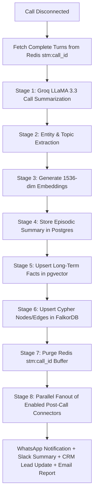

# VoCall — System Architecture Document

**Document Version:** 2.1  
**Last Updated:** September 2026  
**Author:** Lead AI Systems Architect  
**Status:** Approved Specification  
**Related Documents:** [PRD.md](file:///c:/Users/10pri/Downloads/VOCALL%2019%20JULY/latest%20docxxx/PRD.md), [TRD.md](file:///c:/Users/10pri/Downloads/VOCALL%2019%20JULY/latest%20docxxx/TRD.md), [CONNECTORS.md](file:///c:/Users/10pri/Downloads/VOCALL%2019%20JULY/latest%20docxxx/CONNECTORS.md), [MEMORY_GRAPH_RAG.md](file:///c:/Users/10pri/Downloads/VOCALL%2019%20JULY/latest%20docxxx/MEMORY_GRAPH_RAG.md), [INTENT_EMOTION_ENGINE.md](file:///c:/Users/10pri/Downloads/VOCALL%2019%20JULY/latest%20docxxx/INTENT_EMOTION_ENGINE.md)

---

## 1. High-Level 5-Tier Architecture Overview

VoCall utilizes a five-tier microservices architecture separating real-time voice streaming from data storage and asynchronous background evaluation tasks:

```text
┌─────────────────────────────────────────────────────────────────────────────────────────┐
│                                     CLIENT LAYER                                        │
│   Primary Interactive App: Vite 8 + React 19 + Framer Motion 12 (`src/`)                │
│   Enterprise Dashboard: Next.js 14 App Router (`vocall/frontend/`)                      │
│   Agent Studio | WebCallModal Testing | Contacts & 4-Tier Memory | Calls Audit Replay   │
└────────────────────────────┬────────────────────────────────────────────────────────────┘
                             │ REST (HTTPS) + WebRTC (SRTP) / Server-Sent Events (SSE)
┌────────────────────────────▼────────────────────────────────────────────────────────────┐
│                                      API LAYER                                          │
│   FastAPI Backend Service (`app/main.py`)                                               │
│   Routers: /api/v1/auth, /api/v1/agents, /api/v1/calls, /api/v1/contacts,               │
│            /api/connectors, /api/v1/phone-numbers, /api/v1/api-keys, /api/v1/webhooks,  │
│            /api/v1/memory, /api/v1/emotion, /api/v1/intent                              │
│   Streaming: Server-Sent Events (SSE) on /api/v1/calls/webcall/{call_id}/events         │
│   Central Action Connector Dispatcher (`fire_connector()`)                              │
└────┬──────────────┬──────────────┬──────────────┬──────────────┬────────────────────────┘
     │              │              │              │              │
┌────▼────┐   ┌─────▼────┐   ┌─────▼────┐   ┌─────▼────┐   ┌─────▼────────────────────────┐
│Supabase │   │Upstash   │   │FalkorDB  │   │Voice     │   │External Provider APIs        │
│Postgres │   │Redis     │   │(Open-    │   │Pipelines │   │Groq LPU (LLM 70B / Whisper)  │
│pgvector │   │(Short-   │   │ Cypher   │   │LiveKit + │   │Cerebras AI (Fallback LLM)    │
│Auth &   │   │ Term     │   │ Knowledge│   │Pipecat   │   │Sarvam AI (Hinglish STT/TTS)  │
│Storage  │   │ Memory)  │   │ Graph)   │   │WebCall   │   │Cartesia (Sonic-2 TTS)        │
└─────────┘   └──────────┘   └──────────┘   └──────────┘   │Hume AI (EVI Emotion & TTS)   │
┌──────────────────────────────────────────────────────────┤Twilio / Exotel / Plivo (BYOK) │
│   Async Background Layer (Trigger.dev Engine)            │8 Action Connectors (AES-256) │
│   Post-call summary, fact extraction, graph updating     └──────────────────────────────┘
└──────────────────────────────────────────────────────────┘
```

---

## 2. Real-Time Media & Voice Pipelines (WebCall & Telephony)

VoCall provides dual ingress pathways for voice calls:

```text
                                   CALL INGRESS
                                         │
        ┌────────────────────────────────┴────────────────────────────────┐
        ▼                                                                 ▼
[In-Browser WebCall]                                            [Telephony PSTN]
WebRTC SRTP via LiveKit                                         SIP WebSocket via Twilio / Plivo
(`app/services/webcall_pipeline.py`)                           (`app/services/voice_pipeline.py`)
        │                                                                 │
        └────────────────────────────────┬────────────────────────────────┘
                                         ▼
┌─────────────────────────────────────────────────────────────────────────────────────────────┐
│ REAL-TIME VOICE TURN LOOP                                                                   │
│                                                                                             │
│  1. Ingest Audio Packet -> Resample to 16kHz PCM                                           │
│  2. STT Engine: Groq Whisper Large-v3 (English) OR Sarvam Saarika v2 (Hinglish)             │
│  3. Dual Emotion Engine (Parallel):                                                         │
│     - Audio Signal: Hume AI Expression API (43 paralinguistic tone scores -> Circumplex)    │
│     - Text Signal: Groq LLaMA 3.3 70B JSON sentiment extraction                             │
│     - Fused Score: E_fused = 0.6 * Audio + 0.4 * Text                                       │
│  4. VA-ICECoT Engine (`app/services/voice/va_icecot.py`):                                  │
│     - Intention-Centric Chain-of-Thought reasoning with <meta_thought> tags                 │
│     - Dynamic slot extraction & prompt tracking (`slot_manager.py`)                         │
│     - Emotion x Intent Combined Rules Evaluation (`combined_rules.py`)                     │
│     - Auto-fire Resolution Chain Connectors on 100% Slot Completion (`resolver.py`)        │
│  5. LLM Generation: Groq LLaMA 3.3 70B (Streaming, TTFT ~150ms)                             │
│     - If Frustration ≥ 0.70: Inject Adaptive Tone Instruction (`tone_adapter.py`)           │
│  6. TTS Synthesis: Cartesia Sonic-2 (<80ms) OR Sarvam Bulbul / Hume Octave 2                │
│  7. Audio Frame Output to WebRTC Track + SSE Event Streamed to Dashboard                    │
│  8. Turn Appended to Upstash Redis buffer `stm:{call_id}`                                   │
└─────────────────────────────────────────────────────────────────────────────────────────────┘
```

---

## 3. 4-Tier Parallel Memory RAG Engine

```text
                                  INBOUND CALL START
                                          │
                        FastAPI Parallel Memory Fanout (`retrieve_all_memory`)
                                          │
       ┌──────────────────┬───────────────┴───────────────┬──────────────────┐
       │                  │                               │                  │
┌──────▼──────┐    ┌──────▼──────┐                 ┌──────▼──────┐    ┌──────▼──────┐
│ Tier 1:     │    │ Tier 2:     │                 │ Tier 3:     │    │ Tier 4:     │
│ Upstash     │    │ Supabase    │                 │ Supabase    │    │ FalkorDB    │
│ Redis       │    │ pgvector    │                 │ Postgres    │    │ Graph       │
├─────────────┤    ├─────────────┤                 ├─────────────┤    ├─────────────┤
│ Check active│    │ Cosine      │                 │ Last 3      │    │ OpenCypher  │
│ call state /│    │ similarity  │                 │ episodic    │    │ entity &    │
│ resume key  │    │ top-5 facts │                 │ call        │    │ frustration │
│             │    │             │                 │ summaries   │    │ paths       │
└──────┬──────┘    └──────┬──────┘                 └──────┬──────┘    └──────┬──────┘
       │                  │                               │                  │
       └──────────────────┴───────────────┬───────────────┴──────────────────┘
                                          │
                                          ▼
                      System Prompt Dynamic Context Injection:
                      ┌───────────────────────────────────────────────┐
                      │ [RECALLED CONTACT CONTEXT]                    │
                      │ Facts: High-tier customer, prefers Hindi      │
                      │ Episode 1: Refund issue resolved 3 days ago   │
                      │ Graph: Mentions entity 'Invoice-992'          │
                      │ Frustrations: Payment failure recorded        │
                      └───────────────────────────────────────────────┘
```

---

## 4. Action Connectors & Security Architecture

The Action Connector Subsystem provides mid-call tool calling and post-call background synchronizations:

```text
                               ┌────────────────────────────────┐
                               │       CENTRAL DISPATCHER       │
                               │       `fire_connector()`       │
                               │     (Mounted /api/connectors)  │
                               └───────────────┬────────────────┘
                                               │
         ┌─────────────────┬───────────────────┼───────────────────┬─────────────────┐
         │                 │                   │                   │                 │
┌────────▼───────┐ ┌───────▼───────┐   ┌───────▼───────┐   ┌───────▼───────┐ ┌───────▼───────┐
│ WhatsApp       │ │ Google Cal    │   │ HubSpot CRM   │   │ Salesforce    │ │ Slack         │
│ (Twilio API)   │ │ (OAuth2 Free/ │   │ (Contact/Deal)│   │ (OAuth2 Task) │ │ (Block Kit)   │
│ Post-Call SMS  │ │ Busy & Event) │   │               │   │               │ │ Live Alert    │
└────────────────┘ └───────────────┘   └───────────────┘   └───────────────┘ └───────────────┘
         │                 │                   │                   │                 │
┌────────▼───────┐ ┌───────▼───────┐   ┌───────▼───────┐           │                 │
│ Custom Webhook │ │ Supabase / PG │   │ Tone Adapter  │◄──────────┴─────────────────┘
│ (HMAC Signed)  │ │ (SQL Query)   │   │ (Prompt Mod)  │   Mid-Call Emotion Adaptation
└────────────────┘ └───────────────┘   └───────────────┘
```

---

## 5. Asynchronous Background Layer (Trigger.dev Engine)

When a call session completes, the background worker executes an 8-stage post-call workflow in `trigger/post_call_pipeline.py`:



---

Approved by VoCall Technical Architecture Team.
