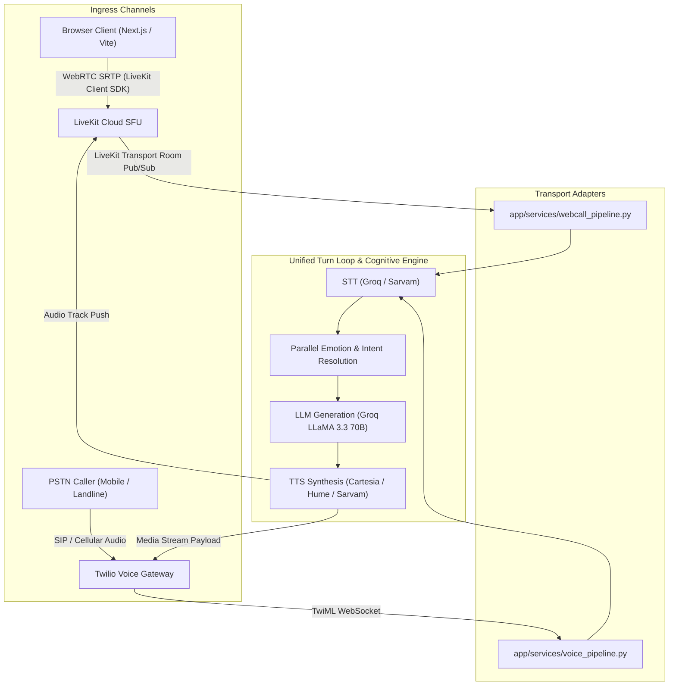
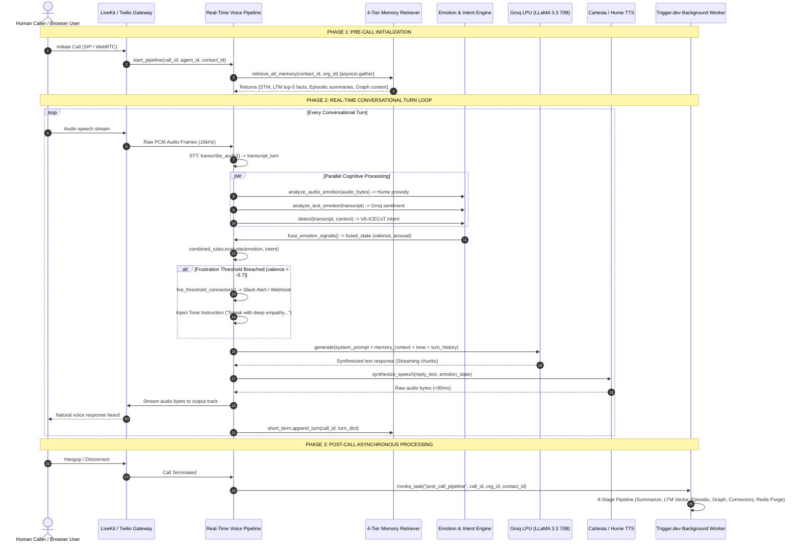
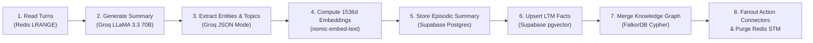

# VoCall System Design Document (HLD & LLD)

**System:** VoCall — Enterprise Multi-Tier Emotion-Aware Voice Agent Platform  
**Document Type:** Combined High-Level Design (HLD) & Low-Level Design (LLD)  
**Version:** 2.0 (Production Release)  
**Date:** July 2026  
**Status:** Approved & Implemented  
**Target Systems:** FastAPI Backend (`app/`), Next.js 14 Dashboard (`vocall/frontend/`), Vite Landing (`src/`), Trigger.dev Async Worker (`trigger/`)

---

## Table of Contents

1. [Executive Summary & System Objectives](#1-executive-summary--system-objectives)
2. [High-Level Design (HLD)](#2-high-level-design-hld)
   - [2.1 5-Tier Architectural Topology](#21-5-tier-architectural-topology)
   - [2.2 Ingress Modalities: WebCall vs Telephony (PSTN)](#22-ingress-modalities-webcall-vs-telephony-pstn)
   - [2.3 End-to-End Call Lifecycle Architecture](#23-end-to-end-call-lifecycle-architecture)
   - [2.4 8-Stage Asynchronous Post-Call Orchestration](#24-8-stage-asynchronous-post-call-orchestration)
   - [2.5 External Services & Infrastructure Boundary Contracts](#25-external-services--infrastructure-boundary-contracts)
   - [2.6 Security, Multi-Tenancy & Auth Model](#26-security-multi-tenancy--auth-model)
3. [Low-Level Design (LLD)](#3-low-level-design-lld)
   - [3.1 Real-Time Voice Turn Loop Subsystem](#31-real-time-voice-turn-loop-subsystem)
   - [3.2 4-Tier Parallel Cognitive Memory Engine](#32-4-tier-parallel-cognitive-memory-engine)
   - [3.3 Dual-Signal Emotion Engine & Paralinguistic Centroid](#33-dual-signal-emotion-engine--paralinguistic-centroid)
   - [3.4 VA-ICECoT Intent Engine & Slot Extractor](#34-va-icecot-intent-engine--slot-extractor)
   - [3.5 Emotion × Intent Combined Rules Engine](#35-emotion--intent-combined-rules-engine)
   - [3.6 Action Connector Dispatcher (Registry Pattern)](#36-action-connector-dispatcher-registry-pattern)
   - [3.7 BYOK AES-256-GCM Cryptographic Subsystem](#37-byok-aes-256-gcm-cryptographic-subsystem)
   - [3.8 LiveKit WebRTC Audio Infrastructure](#38-livekit-webrtc-audio-infrastructure)
   - [3.9 Relational & Vector Database Schema (15 Tables)](#39-relational--vector-database-schema-15-tables)
   - [3.10 FalkorDB Graph Schema & OpenCypher Traversal](#310-falkordb-graph-schema--opencypher-traversal)
4. [Mathematical Formulations](#4-mathematical-formulations)
5. [Non-Functional Requirements & Verification](#5-non-functional-requirements--verification)

---

## 1. Executive Summary & System Objectives

VoCall is an ultra-low latency, emotionally intelligent autonomous voice agent platform designed for production enterprise workflows. It bridges real-time full-duplex conversational audio with 4-tier cognitive memory, dual-signal emotion fusion (audio acoustic prosody + textual sentiment), explicit intent reasoning (VA-ICECoT), and bidirectional third-party CRM/calendar/messaging action execution.

```
+-----------------------------------------------------------------------------------+
|                              VOCALL PLATFORM GOALS                                |
+-----------------------------------------------------------------------------------+
|  1. Sub-800ms Total Voice Turn Latency (STT -> Intent/Emotion -> LLM -> TTS)     |
|  2. Acoustic + Linguistic Emotion Fusion (Russell Circumplex Valence/Arousal)     |
|  3. 4-Tier Memory Fanout (STM Redis + LTM pgvector + Episodic + FalkorDB Graph)   |
|  4. Dynamic Tone Modulation & Autonomous Escalation / Real-time Tool Dispatch     |
|  5. Enterprise BYOK AES-256-GCM Security & DPDP Act 2023 Compliance               |
+-----------------------------------------------------------------------------------+
```

---

## 2. High-Level Design (HLD)

### 2.1 5-Tier Architectural Topology

The VoCall system is organized into five strictly separated tiers ensuring decoupled scaling, high availability, and deterministic latency budgets.

```
========================================================================================================================
                                             VOCALL 5-TIER TOPOLOGY
========================================================================================================================

  [ TIER 1: CLIENT & PRESENTATION ]
  +-------------------------------------+      +-------------------------------------+
  |   Next.js 14 Enterprise Dashboard   |      |   Vite 8 + React 19 Interactive App |
  | (App Router, Tailwind, Lucide, SSE) |      | (WebCallModal, Framer Motion 12)    |
  +-------------------------------------+      +-------------------------------------+
                     |                                            |
                     +---------------------+----------------------+
                                           | HTTPS / WebRTC SRTP / Server-Sent Events (SSE)
                                           v
  [ TIER 2: API GATEWAY & ROUTING ]
  +-----------------------------------------------------------------------------------+
  |                      FastAPI ASGI Layer (Uvicorn / Port 8000)                     |
  |  /api/v1/auth  /api/v1/agents  /api/v1/calls  /api/v1/contacts  /api/connectors   |
  |  /api/v1/phone-numbers  /api/v1/api-keys  /api/v1/webhooks  /api/v1/memory        |
  |  /api/v1/emotion  /api/v1/intent  | SSE: /api/v1/calls/webcall/{call_id}/events   |
  |                 Supabase JWT Auth Middleware | CORS | Rate Limiter                |
  +-----------------------------------------------------------------------------------+
          |                                                             |
          v WebRTC / WebSocket Ingress                                  v Async Trigger
  [ TIER 3: REAL-TIME CONVERSATIONAL MEDIA PIPELINE ]           [ TIER 5: ASYNC WORKER ]
  +-----------------------------------------------+             +----------------------+
  |    Pipecat Real-Time Voice Turn Orchestrator  |             | Trigger.dev Engine   |
  |  - Audio Resampling (16kHz PCM)               |             | 8-Stage Post-Call    |
  |  - STT Router (Groq Whisper / Sarvam Saarika) |             | Background Pipeline: |
  |  - Parallel Dual Emotion (Hume AI + Groq NLP) |             |  * LLM Summary       |
  |  - Intent Engine (VA-ICECoT + Slot Extraction)|             |  * LTM Vector Upsert |
  |  - Combined Rules Engine (Override & Action)  |             |  * Episodic Postgres |
  |  - Dynamic LLM Generator (Groq LLaMA 3.3 70B) |             |  * FalkorDB Graph    |
  |  - TTS Router (Cartesia Sonic-2 / Hume Octave)|             |  * Connector Fanout  |
  |  - LiveKit WebRTC Transport Pub/Sub           |             |  * Redis Buffer Free |
  +-----------------------------------------------+             +----------------------+
          |                                                                |
          +-------------------------------+--------------------------------+
                                          |
                                          v
  [ TIER 4: MULTI-TIER COGNITIVE MEMORY & STORAGE LAYER ]
  +----------------------+  +---------------------+  +--------------------+  +----------------------+
  | Upstash Redis (REST) |  | Supabase (pgvector) |  | Supabase (Postgres)|  | FalkorDB (OpenCypher)|
  | Tier 1: STM Buffer   |  | Tier 2: LTM Vectors |  | Tier 3: Episodic   |  | Tier 4: Entity Graph |
  | `stm:{call_id}`      |  | 1536-dim HNSW Cosine|  | Past call summaries|  | Contact-Entity-Topic |
  +----------------------+  +---------------------+  +--------------------+  +----------------------+
========================================================================================================================
```

### 2.2 Ingress Modalities: WebCall vs Telephony (PSTN)

VoCall supports dual ingress transports with unified downstream cognitive processing:



1. **WebCall Path**: Client initiates session via `POST /api/v1/calls/webcall/start` or mints a room token via `POST /api/v1/calls/token`. The browser connects directly to LiveKit Cloud SFU over WebRTC SRTP (`app/services/webcall_pipeline.py`). Real-time emotion metrics, transcripts, and intent tokens are streamed to the client over Server-Sent Events via `GET /api/v1/calls/webcall/{call_id}/events`. The session terminates via `DELETE /api/v1/calls/webcall/{call_id}/end`.
2. **Telephony Path**: PSTN call enters Twilio phone number. Twilio requests webhook `POST /api/v1/webhooks/twilio/inbound` returning TwiML `<Connect><Stream url="wss://backend/calls/stream/{call_id}"/></Connect>`. Bi-directional audio chunks are streamed over WebSockets (`app/services/voice_pipeline.py`).

---

### 2.3 End-to-End Call Lifecycle Architecture



---

### 2.4 8-Stage Asynchronous Post-Call Orchestration

When a voice call concludes, Trigger.dev invokes `trigger/post_call_pipeline.py` to persist learning across all cognitive memory tiers without blocking media gateways:



1. **Stage 1 (Turn Extraction)**: Reads all chronological turns from Redis `stm:{call_id}` via `LRANGE 0 -1`.
2. **Stage 2 (Call Summarization)**: Calls Groq LLaMA-3.3-70B with full conversation context to extract key resolution outcomes, commitments, and disposition.
3. **Stage 3 (Entity & Fact Extraction)**: Extracts structured entities (account numbers, names, preferences, frustration triggers) in JSON format.
4. **Stage 4 (Vector Embedding)**: Generates 1536-dimensional embeddings for facts and call summary via `nomic-embed-text-v1_5`.
5. **Stage 5 (Episodic Record)**: Writes structured row to `memory_episodic` table in Postgres (linked to `contact_id` and `call_id`).
6. **Stage 6 (Long-Term Memory Upsert)**: Inserts vector embeddings into `memory_long_term` table with pgvector HNSW indexing.
7. **Stage 7 (Knowledge Graph Ingestion)**: Executes OpenCypher queries against FalkorDB, updating `(Contact)-[:MENTIONED]->(Entity)` and `(Contact)-[:FRUSTRATED_ABOUT]->(Topic)`.
8. **Stage 8 (Connector Dispatch & Cleanup)**: Fires all enabled post-call connectors (HubSpot lead, Slack digest, WhatsApp message, Webhooks) and purges `stm:{call_id}` from Redis.

---

### 2.5 External Services & Infrastructure Boundary Contracts

| Service / Provider | Protocol & Transport | Auth Method | Latency Target | Primary Architectural Role |
| :--- | :--- | :--- | :--- | :--- |
| **LiveKit Cloud** | WebRTC SRTP / WebSocket | HMAC API Key + Secret | < 20ms | Low-latency bi-directional voice transport |
| **Groq Cloud LPU** | HTTPS REST / Streaming | Bearer JWT | < 180ms TTFT | Primary conversational LLM, STT, Embedding |
| **Hume AI** | HTTPS REST Multipart | `X-Hume-Api-Key` | ~ 250ms | Paralinguistic voice emotion & Octave 2 TTS |
| **Cartesia AI** | HTTPS REST Binary PCM | `X-API-Key` | < 80ms TTFAB | Ultra-fast English neural voice synthesis |
| **Sarvam AI** | HTTPS REST JSON / Base64 | `api-subscription-key` | < 350ms | Indic / Hinglish STT (Saarika) & TTS (Bulbul) |
| **Supabase Postgres** | TCP / SSL & HTTPS PostgREST | Service Role Key / JWT | < 15ms | Relational data, Auth, pgvector embeddings |
| **Upstash Redis** | HTTPS REST Endpoint | Bearer Token | < 25ms | Real-time short-term memory & SSE broadcast |
| **FalkorDB** | Redis Serialization Protocol | Host / Port Direct | < 10ms | High-throughput Graph RAG (OpenCypher) |
| **Twilio Voice** | SIP / Media Stream WebSocket | Account SID + Auth Token | < 50ms | Global PSTN inbound/outbound telephony |
| **Trigger.dev** | Cloud Task Event Webhook | API Secret Key | Async Background | 8-Stage post-call pipeline execution |

---

### 2.6 Security, Multi-Tenancy & Auth Model

```
+---------------------------------------------------------------------------------+
|                           VOCALL SECURITY ARCHITECTURE                          |
+---------------------------------------------------------------------------------+
|                                                                                 |
|  1. STRICT ORGANIZATION ISOLATION:                                              |
|     Every database table includes `org_id: UUID`. Postgres Row-Level Security   |
|     (RLS) and FastAPI route dependencies enforce `user.org_id == entity.org_id`. |
|                                                                                 |
|  2. AES-256-GCM BYOK CONNECTOR ENCRYPTION:                                      |
|     All third-party credentials (OAuth tokens, API keys) in `connector_configs` |
|     are encrypted at rest with AES-256-GCM using a 96-bit random nonce.         |
|                                                                                 |
|  3. EPHEMERAL IN-CALL MEDIA:                                                    |
|     Audio buffers reside in volatile memory and are never persisted to disk.    |
|     Redis short-term memory keys (`stm:{call_id}`) have strict TTL & post-call  |
|     purge guarantees complying with DPDP Act 2023 "Right to be Forgotten".     |
|                                                                                 |
|  4. JWT AUTHENTICATION FLOW:                                                    |
|     Bearer JWT passed in Authorization header -> Decoded via `get_current_user` |
|     dependency -> Resolves `user_id`, `org_id`, and `role`.                      |
+---------------------------------------------------------------------------------+
```

---

## 3. Low-Level Design (LLD)

### 3.1 Real-Time Voice Turn Loop Subsystem
**Primary Files:** [`app/services/voice_pipeline.py`](file:///c:/Users/10pri/Downloads/VOCALL%2019%20JULY/app/services/voice_pipeline.py) & [`app/services/webcall_pipeline.py`](file:///c:/Users/10pri/Downloads/VOCALL%2019%20JULY/app/services/webcall_pipeline.py)

#### Detailed Step-by-Step Processing:
1. **Audio Resampling**: Input WebRTC/SIP frames are received as 16-bit PCM (8kHz/24kHz/48kHz) and standardized to 16kHz mono PCM.
2. **Speech-to-Text (STT)**: Dispatched to `transcribe_audio()`:
   - English: Groq Whisper Large-v3 (`https://api.groq.com/openai/v1/audio/transcriptions`)
   - Hinglish / Indic: Sarvam Saarika v2 (`https://api.sarvam.ai/speech-to-text`)
3. **Parallel Cognitive Fanout**:
   - Audio acoustic emotion analyzed via Hume AI expression measurement.
   - Text sentiment & valence analyzed via Groq NLP.
   - User intent & slot data classified via VA-ICECoT detector.
4. **Emotion Fusion**: Weighted centroid computed using the Circumplex Model of Affect.
5. **Rule & Tone Adaptation**:
   - `combined_rules.evaluate()` checks for immediate human escalation or response override.
   - `tone_adapter.get_tone_instruction()` appends empathetic steering if valence is negative.
6. **Prompt Assembly**:
   $$\text{SystemPrompt}_{\text{final}} = \text{AgentBasePrompt} + \text{MemoryPrompt} + \text{ToneInstruction} + \text{ActiveToolsSchema}$$
7. **LLM Generation**: Sent to Groq LLaMA-3.3-70B-versatile with stream chunks collected.
8. **TTS Synthesis**: Streamed text response is synthesized into PCM/WAV bytes:
   - English: Cartesia Sonic-2 (<80ms)
   - Emotion-Steered: Hume Octave 2
   - Hinglish: Sarvam Bulbul v2
9. **Media Egress & State Append**: Audio bytes pushed to LiveKit output track; turn recorded to Redis.

---

### 3.2 4-Tier Parallel Cognitive Memory Engine
**Primary Files:** [`app/services/memory/retriever.py`](file:///c:/Users/10pri/Downloads/VOCALL%2019%20JULY/app/services/memory/retriever.py), [`short_term.py`](file:///c:/Users/10pri/Downloads/VOCALL%2019%20JULY/app/services/memory/short_term.py), [`long_term.py`](file:///c:/Users/10pri/Downloads/VOCALL%2019%20JULY/app/services/memory/long_term.py), [`episodic.py`](file:///c:/Users/10pri/Downloads/VOCALL%2019%20JULY/app/services/memory/episodic.py), [`graph.py`](file:///c:/Users/10pri/Downloads/VOCALL%2019%20JULY/app/services/memory/graph.py)

#### Parallel Retrieval Implementation:
```python
async def retrieve_all_memory(
    contact_id: Optional[str],
    org_id: str,
    agent_id: Optional[str] = None,
    query_text: str = "",
    config: Optional[Dict[str, Any]] = None,
) -> Dict[str, Any]:
    config = config or {}
    call_id = config.get("call_id")

    # Fanout tasks concurrently
    short_term_task = (
        short_term.get_call_memory(call_id) if call_id else asyncio.sleep(0, result=None)
    )
    long_term_task = (
        long_term.retrieve_relevant_facts(contact_id, org_id, query_text)
        if contact_id and org_id else asyncio.sleep(0, result=[])
    )
    episodic_task = (
        episodic.get_recent_episodes(contact_id, org_id, limit=config.get("episodic_limit", 3))
        if contact_id and org_id else asyncio.sleep(0, result=[])
    )
    graph_task = (
        _fetch_graph_context(contact_id) if contact_id else asyncio.sleep(0, result={})
    )

    st_res, lt_res, ep_res, gr_res = await asyncio.gather(
        short_term_task, long_term_task, episodic_task, graph_task, return_exceptions=True
    )

    return {
        "short_term": st_res if not isinstance(st_res, Exception) else None,
        "long_term": lt_res if isinstance(lt_res, list) else [],
        "episodic": ep_res if isinstance(ep_res, list) else [],
        "graph": gr_res if isinstance(gr_res, dict) else {},
    }
```

---

### 3.3 Dual-Signal Emotion Engine & Paralinguistic Centroid
**Primary Files:** [`app/services/emotion/fusion.py`](file:///c:/Users/10pri/Downloads/VOCALL%2019%20JULY/app/services/emotion/fusion.py) & [`audio_signal.py`](file:///c:/Users/10pri/Downloads/VOCALL%2019%20JULY/app/services/emotion/audio_signal.py)

#### Fusion Engine Implementation:
```python
def fuse_emotion_signals(
    text: Optional[Dict[str, Any]],
    audio: Optional[Dict[str, Any]],
) -> Dict[str, Any]:
    now_ms = int(time.time() * 1000)

    if audio is not None and isinstance(audio, dict):
        audio_val = float(audio.get("valence", 0.0))
        audio_aro = float(audio.get("arousal", 0.5))
        audio_dom = str(audio.get("dominant", "neutral"))
        audio_conf = float(audio.get("confidence", 0.5))

        if text is not None and isinstance(text, dict):
            text_val = float(text.get("valence", 0.0))
            text_aro = float(text.get("arousal", 0.5))
            text_dom = str(text.get("dominant", "neutral"))
            text_conf = float(text.get("confidence", 0.5))

            # Dual Signal Weighted Blend (60% acoustic prosody / 40% linguistic semantic)
            valence = 0.6 * audio_val + 0.4 * text_val
            arousal = 0.6 * audio_aro + 0.4 * text_aro
            dominant = audio_dom if audio_conf > 0.6 else text_dom
            confidence = max(audio_conf, text_conf)
        else:
            valence, arousal, dominant, confidence = audio_val, audio_aro, audio_dom, audio_conf

    elif text is not None and isinstance(text, dict):
        valence = float(text.get("valence", 0.0))
        arousal = float(text.get("arousal", 0.5))
        dominant = str(text.get("dominant", "neutral"))
        confidence = float(text.get("confidence", 0.5))
    else:
        valence, arousal, dominant, confidence = 0.0, 0.5, "neutral", 0.0

    return {
        "valence": round(max(-1.0, min(1.0, valence)), 3),
        "arousal": round(max(0.0, min(1.0, arousal)), 3),
        "dominant": dominant,
        "confidence": round(max(0.0, min(1.0, confidence)), 3),
        "timestamp": now_ms,
    }
```

---

### 3.4 VA-ICECoT Intent Engine & Slot Extractor
**Primary File:** [`app/services/intent/detector.py`](file:///c:/Users/10pri/Downloads/VOCALL%2019%20JULY/app/services/intent/detector.py)

#### Intent Detection Implementation:
```python
SYSTEM_INTENTS = [
    "book_appointment", "request_refund", "check_status", "get_invoice",
    "update_details", "cancel_service", "speak_to_human", "lead_qualification",
    "general_inquiry", "complaint", "unknown",
]

async def detect(
    transcript_turn: str,
    emotion_state: Dict[str, Any],
    conversation_history: Optional[List[Dict[str, str]]] = None,
    agent_intents: Optional[List[Dict[str, Any]]] = None,
    filled_slots: Optional[Dict[str, Any]] = None,
) -> Dict[str, Any]:
    if not transcript_turn or not transcript_turn.strip():
        return {"intent": "unknown", "confidence": 0.0, "intent_articulation": "No speech provided.", "entities": [], "slot_data": {}, "is_terminal": False}

    custom_slugs = [i.get("slug") for i in (agent_intents or []) if isinstance(i, dict)]
    all_intents = SYSTEM_INTENTS + [s for s in custom_slugs if s and s not in SYSTEM_INTENTS]

    prompt = f"""You are an intent detection AI analyzing a voice call transcript turn.
The caller just said: "{transcript_turn}"
Context: Caller need: {emotion_state.get('caller_need', '')}, Slots: {json.dumps(filled_slots or {})}
Available intents: {json.dumps(all_intents)}

Return ONLY valid JSON:
{{
  "intent": "one of available intents",
  "confidence": 0.85,
  "intent_articulation": "To [verb] [what] — concise statement of intent",
  "entities": ["entity1"],
  "slot_data": {{"key": "value"}},
  "secondary_intent": null,
  "is_terminal": false
}}"""

    raw_response = await llm_service.generate(
        prompt="You are a strict JSON-only intent extraction model.",
        messages=[{"role": "user", "content": prompt}],
    )
    # Parse cleaned JSON safely with general_inquiry fallback
    ...
```

---

### 3.5 Emotion × Intent Combined Rules Engine
**Primary File:** [`app/services/intent/combined_rules.py`](file:///c:/Users/10pri/Downloads/VOCALL%2019%20JULY/app/services/intent/combined_rules.py)

#### System Rules Matrix:
```python
SYSTEM_COMBINED_RULES: List[Dict[str, Any]] = [
    {
        "id": "refund_frustrated",
        "intent": "request_refund",
        "emotion_condition": {"valence_lt": -0.5},
        "action": "human_handoff",
        "instruction": "Caller is requesting refund AND highly frustrated. Escalate immediately.",
        "skip_llm_response": False,
    },
    {
        "id": "speak_to_human_angry",
        "intent": "speak_to_human",
        "emotion_condition": {"dominant_in": ["angry", "frustrated"]},
        "action": "human_handoff",
        "instruction": "Transfer immediately to human agent without attempting resolution.",
        "skip_llm_response": True,
    },
    {
        "id": "appointment_positive",
        "intent": "book_appointment",
        "emotion_condition": {"valence_gt": 0.4},
        "action": "none",
        "instruction": "Caller is in positive mood. Confirm appointment details confidently.",
        "skip_llm_response": False,
    },
]
```

---

### 3.6 Action Connector Dispatcher (Registry Pattern)
**Primary File:** [`app/services/connectors/dispatcher.py`](file:///c:/Users/10pri/Downloads/VOCALL%2019%20JULY/app/services/connectors/dispatcher.py)

#### Registry-Driven Dispatch:
```python
CONNECTOR_REGISTRY: Dict[str, Callable] = {
    "google":     _handle_google_cal,
    "calendar":   _handle_google_cal,
    "hubspot":    _handle_hubspot,
    "salesforce": _handle_salesforce,
    "webhook":    _handle_webhook,
    "zapier":     _handle_webhook,
    "whatsapp":   _handle_whatsapp,
    "slack":      _handle_slack,
    "supabase":   _handle_supabase,
    "postgres":   _handle_supabase,
}

async def fire_connector(
    connector_type: str, config: Dict[str, Any], payload: Dict[str, Any]
) -> Dict[str, Any]:
    ctype = connector_type.lower()
    handler = next((fn for key, fn in CONNECTOR_REGISTRY.items() if key in ctype), None)
    if handler is None:
        return {"success": False, "error": f"Unknown connector type '{connector_type}'"}
    return await handler(config, payload)
```

---

### 3.7 BYOK AES-256-GCM Cryptographic Subsystem
**Primary File:** [`app/utils/encryption.py`](file:///c:/Users/10pri/Downloads/VOCALL%2019%20JULY/app/utils/encryption.py)

#### Cryptographic Architecture:
```python
from cryptography.hazmat.primitives.ciphers.aead import AESGCM

KEY_BYTES = bytes.fromhex(os.environ.get("ENCRYPTION_KEY", "..."))  # 32 bytes (256-bit)

def encrypt_config(config: dict) -> str:
    plaintext = json.dumps(config).encode("utf-8")
    aesgcm = AESGCM(KEY_BYTES)
    nonce = os.urandom(12)  # 96-bit unique random nonce per operation
    ciphertext = aesgcm.encrypt(nonce, plaintext, None)
    # Stored payload: Base64( Nonce_12bytes || Ciphertext_Nbytes_with_16byte_Auth_Tag )
    return base64.b64encode(nonce + ciphertext).decode("utf-8")

def decrypt_config(ciphertext: Any) -> dict:
    raw = base64.b64decode(ciphertext_str)
    nonce = raw[:12]
    encrypted_data = raw[12:]
    aesgcm = AESGCM(KEY_BYTES)
    plaintext = aesgcm.decrypt(nonce, encrypted_data, None)
    return json.loads(plaintext.decode("utf-8"))
```

---

### 3.8 LiveKit WebRTC Audio Infrastructure
**Primary File:** [`app/services/livekit_service.py`](file:///c:/Users/10pri/Downloads/VOCALL%2019%20JULY/app/services/livekit_service.py)

#### Service Capabilities:
- **Room Naming**: Uniform format `call-{call_id}`.
- **Room Lifecycle**: `empty_timeout=300s` (auto-close after 5 min empty), `departure_timeout=10s`.
- **Token Generation**:
  - `generate_agent_token()`: `can_publish=True`, `can_subscribe=True`, `can_publish_data=True` (audio only, no video grants).
  - `generate_caller_token()`: `can_publish=True`, `can_subscribe=True`, `can_publish_data=False`.
  - Dev Fallback: Returns `dev_token_{room}_{identity}_{timestamp}` when keys are unconfigured.

---

### 3.9 Relational & Vector Database Schema (15 Tables)

```sql
-- 1. Organizations
CREATE TABLE orgs (
    id UUID PRIMARY KEY DEFAULT gen_random_uuid(),
    name TEXT NOT NULL,
    created_at TIMESTAMPTZ DEFAULT now()
);

-- 2. Users (Linked with Supabase Auth)
CREATE TABLE users (
    id UUID PRIMARY KEY REFERENCES auth.users(id) ON DELETE CASCADE,
    org_id UUID NOT NULL REFERENCES orgs(id) ON DELETE CASCADE,
    email TEXT NOT NULL,
    role TEXT DEFAULT 'member',
    created_at TIMESTAMPTZ DEFAULT now()
);

-- 3. Spaces (Workspaces within Orgs)
CREATE TABLE spaces (
    id UUID PRIMARY KEY DEFAULT gen_random_uuid(),
    org_id UUID NOT NULL REFERENCES orgs(id) ON DELETE CASCADE,
    name TEXT NOT NULL,
    created_at TIMESTAMPTZ DEFAULT now()
);

-- 4. Voice Agents
CREATE TABLE agents (
    id UUID PRIMARY KEY DEFAULT gen_random_uuid(),
    org_id UUID NOT NULL REFERENCES orgs(id) ON DELETE CASCADE,
    space_id UUID REFERENCES spaces(id) ON DELETE SET NULL,
    name TEXT NOT NULL,
    voice_provider TEXT DEFAULT 'cartesia',
    voice_id TEXT DEFAULT '79a125e8-cd45-4c13-8a25-89665a53543c',
    prompt TEXT NOT NULL,
    config JSONB DEFAULT '{}',
    is_active BOOLEAN DEFAULT true,
    created_at TIMESTAMPTZ DEFAULT now()
);

-- 5. Contacts (Caller Directory)
CREATE TABLE contacts (
    id UUID PRIMARY KEY DEFAULT gen_random_uuid(),
    org_id UUID NOT NULL REFERENCES orgs(id) ON DELETE CASCADE,
    name TEXT NOT NULL,
    phone TEXT NOT NULL,
    email TEXT,
    tags TEXT[] DEFAULT '{}',
    created_at TIMESTAMPTZ DEFAULT now()
);

-- 6. Calls
CREATE TABLE calls (
    id UUID PRIMARY KEY DEFAULT gen_random_uuid(),
    org_id UUID NOT NULL REFERENCES orgs(id) ON DELETE CASCADE,
    agent_id UUID NOT NULL REFERENCES agents(id),
    contact_id UUID REFERENCES contacts(id) ON DELETE SET NULL,
    direction TEXT NOT NULL, -- 'inbound' | 'outbound' | 'webcall'
    status TEXT DEFAULT 'initiated', -- 'active' | 'completed' | 'failed'
    duration_seconds INT DEFAULT 0,
    recording_url TEXT,
    created_at TIMESTAMPTZ DEFAULT now()
);

-- 7. Call Turns
CREATE TABLE call_turns (
    id UUID PRIMARY KEY DEFAULT gen_random_uuid(),
    call_id UUID NOT NULL REFERENCES calls(id) ON DELETE CASCADE,
    speaker TEXT NOT NULL, -- 'user' | 'agent' | 'system'
    transcript TEXT NOT NULL,
    emotion_state JSONB,
    intent_state JSONB,
    latency_ms INT,
    created_at TIMESTAMPTZ DEFAULT now()
);

-- 8. Short-Term Memory Fallback Table
CREATE TABLE memory_short_term (
    call_id UUID PRIMARY KEY REFERENCES calls(id) ON DELETE CASCADE,
    turns JSONB NOT NULL DEFAULT '[]',
    updated_at TIMESTAMPTZ DEFAULT now()
);

-- 9. Long-Term Semantic Memory (pgvector 1536-dim)
CREATE EXTENSION IF NOT EXISTS vector;
CREATE TABLE memory_long_term (
    id UUID PRIMARY KEY DEFAULT gen_random_uuid(),
    org_id UUID NOT NULL REFERENCES orgs(id) ON DELETE CASCADE,
    contact_id UUID NOT NULL REFERENCES contacts(id) ON DELETE CASCADE,
    content TEXT NOT NULL,
    embedding vector(1536) NOT NULL,
    emotion_state JSONB,
    created_at TIMESTAMPTZ DEFAULT now()
);
CREATE INDEX ON memory_long_term USING hnsw (embedding vector_cosine_ops);

-- 10. Episodic Memory (Call Summaries)
CREATE TABLE memory_episodic (
    id UUID PRIMARY KEY DEFAULT gen_random_uuid(),
    org_id UUID NOT NULL REFERENCES orgs(id) ON DELETE CASCADE,
    contact_id UUID NOT NULL REFERENCES contacts(id) ON DELETE CASCADE,
    call_id UUID REFERENCES calls(id) ON DELETE SET NULL,
    summary TEXT NOT NULL,
    disposition TEXT,
    created_at TIMESTAMPTZ DEFAULT now()
);

-- 11. Graph Node References
CREATE TABLE memory_graph_nodes (
    id UUID PRIMARY KEY DEFAULT gen_random_uuid(),
    contact_id UUID NOT NULL REFERENCES contacts(id) ON DELETE CASCADE,
    node_type TEXT NOT NULL, -- 'entity' | 'topic' | 'episode'
    name TEXT NOT NULL,
    metadata JSONB DEFAULT '{}',
    created_at TIMESTAMPTZ DEFAULT now()
);

-- 12. Connector Configurations (Encrypted BYOK)
CREATE TABLE connector_configs (
    id UUID PRIMARY KEY DEFAULT gen_random_uuid(),
    org_id UUID NOT NULL REFERENCES orgs(id) ON DELETE CASCADE,
    agent_id UUID REFERENCES agents(id) ON DELETE CASCADE,
    connector_type TEXT NOT NULL,
    config TEXT NOT NULL, -- AES-256-GCM encrypted base64 string
    is_enabled BOOLEAN DEFAULT true,
    created_at TIMESTAMPTZ DEFAULT now()
);

-- 13. Organization API Keys (Hume, Cartesia, Groq BYOK)
CREATE TABLE api_keys (
    id UUID PRIMARY KEY DEFAULT gen_random_uuid(),
    org_id UUID NOT NULL REFERENCES orgs(id) ON DELETE CASCADE,
    provider TEXT NOT NULL,
    encrypted_key TEXT NOT NULL,
    created_at TIMESTAMPTZ DEFAULT now()
);

-- 14. Inbound / Outbound Phone Numbers
CREATE TABLE phone_numbers (
    id UUID PRIMARY KEY DEFAULT gen_random_uuid(),
    org_id UUID NOT NULL REFERENCES orgs(id) ON DELETE CASCADE,
    agent_id UUID REFERENCES agents(id) ON DELETE SET NULL,
    phone_number TEXT NOT NULL UNIQUE,
    provider TEXT DEFAULT 'twilio',
    is_active BOOLEAN DEFAULT true,
    created_at TIMESTAMPTZ DEFAULT now()
);

-- 15. Webhooks Configuration
CREATE TABLE webhooks (
    id UUID PRIMARY KEY DEFAULT gen_random_uuid(),
    org_id UUID NOT NULL REFERENCES orgs(id) ON DELETE CASCADE,
    url TEXT NOT NULL,
    events TEXT[] NOT NULL,
    secret TEXT,
    is_active BOOLEAN DEFAULT true,
    created_at TIMESTAMPTZ DEFAULT now()
);
```

---

### 3.10 FalkorDB Graph Schema & OpenCypher Traversal
**Primary File:** [`app/services/memory/graph.py`](file:///c:/Users/10pri/Downloads/VOCALL%2019%20JULY/app/services/memory/graph.py)

#### Graph Topology & Cypher Operations:
```cypher
// Graph Name Format: contact_<contact_id_with_underscores>

// 1. Merge Contact Node
MERGE (c:Contact {id: $contact_id})
ON CREATE SET c.name = $name, c.phone = $phone;

// 2. Merge Mentioned Entities and Occurrences
MERGE (e:Entity {name: $entity_name})
MERGE (c)-[:MENTIONED]->(e)
MERGE (ep:Episode {id: $episode_id, call_id: $call_id, summary: $summary})
MERGE (e)-[:OCCURRED_IN]->(ep);

// 3. Upsert Frustration Topic Node with Counter
MERGE (t:Topic {name: $topic_name})
MERGE (c)-[r:FRUSTRATED_ABOUT]->(t)
ON CREATE SET r.count = 1, r.last_seen = $now
ON MATCH SET r.count = r.count + 1, r.last_seen = $now;

// 4. Link Episodic Causal Chain
MERGE (prev:Episode {id: $prev_episode_id})
MERGE (curr:Episode {id: $curr_episode_id})
MERGE (prev)-[:LEADS_TO]->(curr);

// 5. Query Active Contact Graph Context for LLM Ingestion
MATCH (c:Contact {id: $contact_id})-[r:FRUSTRATED_ABOUT]->(t:Topic)
RETURN t.name AS topic, r.count AS frequency
ORDER BY r.count DESC LIMIT 5;
```

---

## 4. Mathematical Formulations

### Equation 1: Dual-Signal Emotion Fusion
When both acoustic prosody ($A$) and linguistic semantics ($T$) are present:
$$\text{Valence}_{\text{fused}} = 0.6 \cdot \text{Valence}_{A} + 0.4 \cdot \text{Valence}_{T}$$
$$\text{Arousal}_{\text{fused}} = 0.6 \cdot \text{Arousal}_{A} + 0.4 \cdot \text{Arousal}_{T}$$
$$\text{Dominant}_{\text{fused}} = \begin{cases} \text{Dominant}_{A}, & \text{if } \text{Confidence}_{A} > 0.6 \\ \text{Dominant}_{T}, & \text{otherwise} \end{cases}$$
$$\text{Confidence}_{\text{fused}} = \max(\text{Confidence}_{A}, \text{Confidence}_{T})$$

### Equation 2: Audio Emotion Centroid (Circumplex Model of Affect)
Given $N$ emotion scores $s_i \in [0, 1]$ from Hume AI and circumplex coordinates $(v_i, a_i) \in [-1, 1] \times [0, 1]$:
$$\text{Valence}_{A} = \frac{\sum_{i=1}^{N} s_i \cdot v_i}{\sum_{i=1}^{N} s_i}, \quad \text{Arousal}_{A} = \frac{\sum_{i=1}^{N} s_i \cdot a_i}{\sum_{i=1}^{N} s_i}$$

### Equation 3: Frustration Score & Threshold Trigger
$$\text{FrustrationScore} = |\text{Valence}_{\text{fused}}| \quad \text{for } \text{Valence}_{\text{fused}} < 0$$
$$\text{TriggerAlert} = \begin{cases} \text{True}, & \text{if } \text{Valence}_{\text{fused}} < -\theta_{\text{frustration}} \quad (\text{default } \theta = 0.7) \\ \text{False}, & \text{otherwise} \end{cases}$$

### Equation 4: Vector Cosine Similarity (pgvector)
Given query embedding vector $\mathbf{q} \in \mathbb{R}^{1536}$ and stored fact embedding $\mathbf{f}_k \in \mathbb{R}^{1536}$:
$$\text{CosineSimilarity}(\mathbf{q}, \mathbf{f}_k) = \frac{\mathbf{q} \cdot \mathbf{f}_k}{\|\mathbf{q}\| \|\mathbf{f}_k\|} = \frac{\sum_{j=1}^{1536} q_j f_{kj}}{\sqrt{\sum_{j=1}^{1536} q_j^2} \sqrt{\sum_{j=1}^{1536} f_{kj}^2}}$$

### Equation 5: Joint Recognition Balance Metric (JRBM Benchmark)
Harmonic balance between intent classification accuracy ($\text{Acc}_{\text{intent}}$) and emotion recognition accuracy ($\text{Acc}_{\text{emotion}}$):
$$\text{JRBM} = \frac{2 \cdot \text{Acc}_{\text{intent}} \cdot \text{Acc}_{\text{emotion}}}{\text{Acc}_{\text{intent}} + \text{Acc}_{\text{emotion}}}$$

---

## 5. Non-Functional Requirements & Verification

| Requirement Category | Specification | Verification Method |
| :--- | :--- | :--- |
| **Turn Latency** | $< 800\text{ms}$ total turn latency ($P95$) | Measured in `call_turns.latency_ms` via Pipecat event timestamps |
| **Audio Quality** | 16kHz/24kHz high fidelity, $< 1\%$ packet loss | LiveKit WebRTC Stats & jitter buffer telemetry |
| **Memory Isolation** | 100% tenant separation by `org_id` | Tested via `tests/test_agents.py` & `test_contacts.py` |
| **Fault Tolerance** | Automatic fallback to Cartesia if Hume/Sarvam fails | Verified in `tests/test_stt_tts_hinglish.py` |
| **Cryptography** | AES-256-GCM with 96-bit random nonce | Unit tested in `app/utils/encryption.py` sanity check |
| **Compliance** | Complete erasure of STM, LTM, Episodic, Graph | Verified via `DELETE /api/v1/contacts/{id}/memory` DPDP test |

---

*Document Authoritative Source: `latest docxxx/system_design.md` — VoCall Engineering Architecture Group.*
