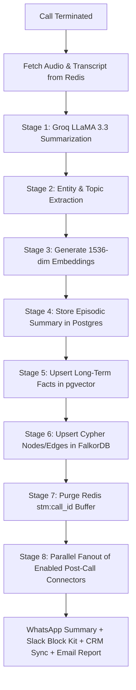

# VoCall — Technical Requirements Document (TRD)

**Document Version:** 2.0  
**Status:** Engineering Baseline  
**Date:** July 2026  
**Author:** Lead AI Systems Architect  
**Target Platform:** VoCall Voice AI Platform Engine  
**Related Documents:** [PRD.md](file:///c:/Users/10pri/Downloads/VOCALL%2019%20JULY/vocall/docs/PRD.md), [architecture.md](file:///c:/Users/10pri/Downloads/VOCALL%2019%20JULY/vocall/docs/architecture.md)

---

## 1. System Overview & Technology Stack

VoCall's technical architecture is engineered to resolve three primary challenges in voice AI: **high latency**, **contextual amnesia**, and **emotional blindness**. The system utilizes a hybrid serverless + real-time WebSocket/WebRTC microservices architecture.

```text
┌─────────────────────────────────────────────────────────────────────────────────────────────┐
│                                 VOCALL TECHNOLOGY STACK                                      │
├───────────────────┬─────────────────────────────────────────────────────────────────────────┤
│ **Frontend App**  │ Next.js 14 (App Router), React 18, TypeScript, Tailwind CSS v4, Lucide  │
│ **Landing Page**  │ React 18, Vite, Tailwind CSS v4                                         │
│ **Backend API**   │ Python 3.10+, FastAPI, Uvicorn, Pydantic v2, Asyncio                   │
│ **Media Engine**  │ Pipecat AI Framework, LiveKit Cloud WebRTC Server                       │
│ **LLM Engine**    │ Groq LPU (llama-3.3-70b-versatile), Cerebras AI (Fallback)             │
│ **STT Engine**    │ Groq Whisper Large-v3 (English), Sarvam AI Saarika v2 (Hindi/Hinglish)  │
│ **TTS Engine**    │ Cartesia Sonic-2 (English), Sarvam Bulbul v2 (Hinglish), Hume Octave 2 │
│ **Emotion Engine**│ Hume AI EVI / Expression API (Audio) + Groq NLP JSON (Text)             │
│ **Intent Engine** │ VA-ICECoT (Voice Agent Intention-Centric Chain-of-Thought)             │
│ **Databases**     │ Supabase Postgres + pgvector, Upstash Redis, FalkorDB Graph             │
│ **Connectors**    │ 8 Action Connectors (WhatsApp, GCal, HubSpot, SF, Slack, Webhook, SQL) │
│ **Security**      │ AES-256-GCM BYOK Credential Encryption, DPDP 2023 "Forget Me" Engine   │
│ **Background**    │ Trigger.dev Engine                                                      │
│ **Telephony**     │ Twilio, Exotel, Plivo (BYOK)                                            │
└───────────────────┴─────────────────────────────────────────────────────────────────────────┘
```

---

## 2. End-to-End Pipeline Latency Budget

```mermaid
gantt
    title Sub-500ms Real-Time Voice Turn Execution Budget
    dateFormat  X
    axisFormat %s ms

    section Caller Audio
    STT Audio Chunking & Ingestion       :active, 0, 40
    STT Inference (Groq Whisper / Sarvam) :crit, 40, 190

    section Emotion & Context
    Parallel Audio/Text Emotion Fusion   : 190, 220
    Parallel 4-Tier Memory RAG Lookups   : 190, 240

    section LLM Generation
    First-Token Generation (Groq LPU)    :active, 240, 390

    section Synthesis & Output
    TTS Audio Synthesis (Cartesia / Hume):crit, 390, 470
    WebRTC Packet Transmission           : 470, 495
```



- **Total Latency Budget:** $\le 495\text{ ms}$
- **STT (Groq Whisper / Sarvam Saarika):** $\sim 150\text{ ms}$
- **Emotion & Context Fanout:** $\sim 30\text{ ms}$ (executed concurrently)
- **LLM TTFT (Groq LLaMA 3.3 70B):** $\sim 150\text{ ms}$
- **TTS TTFAB (Cartesia Sonic-2 / Sarvam Bulbul):** $\sim 80\text{ ms}$
- **Network Transport (WebRTC SRTP):** $\sim 25\text{ ms}$

---

## 3. Real-Time Streaming Architecture (Pipecat + LiveKit)

### 3.1 WebRTC Session Lifecycle (`/webcall`)

```text
1. Browser Client opens WebCallModal ("Ananya UI")
2. POST /api/v1/calls/token { agent_id, contact_name }
   ├── FastAPI validates agent & contact (creates contact row if new)
   ├── Issue LiveKit WebRTC AccessToken with room permissions (`call-{call_id}`)
   └── Returns { token, room_name, call_id }
3. Client connects to LiveKit Cloud Room (wss://livekit.cloud)
4. FastAPI spawns Pipecat Pipeline Instance:
   ├── Attach AudioFrameSubscriber to LiveKit AudioTrack
   ├── Initialize Redis STM key stm:{call_id}
   ├── Perform parallel 4-tier memory retrieval (`retrieve_all_memory`)
   ├── Inject context into system prompt
   └── Pipeline Loop: AudioIn -> STT -> Emotion -> LLM -> TTS -> AudioOut
```

### 3.2 Inbound Telephony Session Lifecycle (`/webhooks/twilio`)

```text
1. Caller dials Twilio PSTN Phone Number
2. Twilio sends HTTP POST to FastAPI `/api/v1/webhooks/twilio/inbound`
3. FastAPI looks up agent by `phone_number` and contact by `caller_id`
4. FastAPI returns TwiML Response:
   <Response>
     <Connect>
       <Stream url="wss://backend.vocall.ai/ws/twilio/{call_id}" />
     </Connect>
   </Response>
5. Twilio opens bidirectional WebSocket stream (8kHz mulaw audio)
6. FastAPI transcodes audio to 16kHz PCM and feeds into Pipecat pipeline loop
```

---

## 4. Multi-Tier Cognitive Memory Engine Specifications

```text
┌────────────────────────┬─────────────────────────┬──────────────────────────┬────────────────────────┐
│ TIER 1: SHORT-TERM     │ TIER 2: LONG-TERM       │ TIER 3: EPISODIC         │ TIER 4: KNOWLEDGE GRAPH│
├────────────────────────┼─────────────────────────┼──────────────────────────┼────────────────────────┤
│ **Storage Engine:**    │ **Storage Engine:**     │ **Storage Engine:**      │ **Storage Engine:**    │
│ Upstash Redis (REST)   │ Supabase pgvector       │ Supabase PostgreSQL      │ FalkorDB (OpenCypher)  │
│ **Key / Table:**       │ **Key / Table:**        │ **Key / Table:**         │ **Key / Table:**       │
│ `stm:{call_id}`        │ `memory_long_term`      │ `memory_episodic`        │ `Contact`, `Episode`,  │
│                        │                         │                          │ `Entity`, `Topic`      │
│ **Vector Size:**       │ **Vector Size:**        │ **Vector Size:**         │ **Vector Size:**       │
│ N/A (JSON buffer)      │ 1536-dim (OpenAI)       │ N/A (Relational JSON)    │ N/A (Graph nodes/edges)│
│ **Retrieval Latency:** │ **Retrieval Latency:**  │ **Retrieval Latency:**   │ **Retrieval Latency:** │
│ < 5 ms                 │ < 30 ms (HNSW cosine)   │ < 15 ms                  │ < 10 ms (In-memory)    │
└────────────────────────┴─────────────────────────┴──────────────────────────┴────────────────────────┘
```

---

## 5. Asynchronous Post-Call Processing Pipeline (Trigger.dev)

Upon call disconnect (`livekit_events` webhook or PSTN hangup), the 8-stage post-call pipeline executes asynchronously:



---

## 6. Database Schema Inventory (15 Supabase Tables)

| Table Name | Description | Key Indexes |
| :--- | :--- | :--- |
| `organizations` | Tenant isolation accounts | `id (PK)` |
| `users` | Org members and role permissions | `id (PK), org_id (FK), email` |
| `agents` | Agent prompt, voice, and telephony configuration | `id (PK), org_id (FK)` |
| `contacts` | End-user caller records | `id (PK), org_id (FK), phone` |
| `calls` | Detailed call session metadata and metrics | `id (PK), org_id (FK), agent_id (FK), contact_id (FK)` |
| `call_transcripts` | Turn-by-turn spoken conversation logs | `id (PK), call_id (FK), turn_index` |
| `emotion_events` | Granular valence/arousal/frustration logs | `id (PK), call_id (FK), timestamp` |
| `intent_events` | Detected intents and slot key-values | `id (PK), call_id (FK)` |
| `memory_long_term` | Semantic fact vector embeddings | `id (PK), contact_id (FK), HNSW (embedding)` |
| `memory_episodic` | Chronological past call episode summaries | `id (PK), contact_id (FK), call_id (FK)` |
| `phone_numbers` | Provisioned Twilio / Exotel / Plivo numbers | `id (PK), org_id (FK), phone_number` |
| `connector_configs` | Encrypted third-party action configurations | `id (PK), org_id (FK), type` |
| `connector_logs` | Audit trail of connector executions | `id (PK), call_id (FK), connector_id (FK)` |
| `api_keys` | Organization developer API access tokens | `id (PK), org_id (FK), key_hash` |
| `compliance_logs` | DPDP / TRAI privacy and consent audit logs | `id (PK), org_id (FK), contact_id (FK)` |

---

Approved by VoCall Technical Architecture Team.
