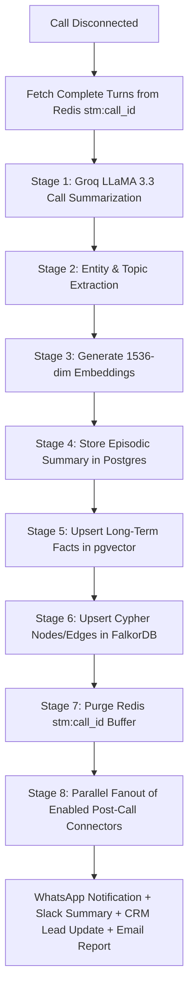

# VoCall — System Architecture Document

**Document Version:** 2.0  
**Last Updated:** July 2026  
**Author:** Lead AI Systems Architect  
**Status:** Approved Specification  
**Related Documents:** [PRD.md](file:///c:/Users/10pri/Downloads/VOCALL%2019%20JULY/vocall/docs/PRD.md), [TRD.md](file:///c:/Users/10pri/Downloads/VOCALL%2019%20JULY/vocall/docs/TRD.md)

---

## 1. High-Level 5-Tier Architecture Overview

VoCall utilizes a five-tier microservices architecture separating real-time voice streaming from data storage and asynchronous background evaluation tasks:

```text
┌─────────────────────────────────────────────────────────────────────────────────────────┐
│                                     CLIENT LAYER                                        │
│   Next.js 14 Frontend (Vercel) / React Vite Landing Page                                │
│   Dashboard | Agent Studio | Contacts & 4-Tier Memory | WebCallModal ("Ananya UI")      │
└────────────────────────────┬────────────────────────────────────────────────────────────┘
                             │ REST (HTTPS) + WebRTC (SRTP) / WebSockets (WSS)
┌────────────────────────────▼────────────────────────────────────────────────────────────┐
│                                      API LAYER                                          │
│   FastAPI Backend Service (Railway / Docker)                                            │
│   Auth | Agent Router | Call Controller | 4-Tier Memory RAG | Emotion Fusion Engine     │
│   Intent & Compliance Router | VA-ICECoT Engine (Intent/Slot Classifier & Combined Rules) │
│   Central Action Connector Dispatcher (`fire_connector()`)                              │
└────┬──────────────┬──────────────┬──────────────┬──────────────┬────────────────────────┘
     │              │              │              │              │
┌────▼────┐   ┌─────▼────┐   ┌─────▼────┐   ┌─────▼────┐   ┌─────▼────────────────────────┐
│Supabase │   │Upstash   │   │FalkorDB  │   │Voice     │   │External Provider APIs        │
│Postgres │   │Redis     │   │(Cypher   │   │Pipeline  │   │Groq LPU (LLM 70B / Whisper)  │
│pgvector │   │(Short-   │   │ Knowledge│   │Pipecat + │   │Cerebras AI (Fallback LLM)    │
│Auth &   │   │ Term     │   │ Graph)   │   │LiveKit   │   │Sarvam AI (Hinglish STT/TTS)  │
│Storage  │   │ Memory)  │   └──────────┘   └──────────┘   │Cartesia (Sonic-2 TTS)        │
└─────────┘   └──────────┘                                 │Hume AI (EVI Emotion & TTS)   │
┌──────────────────────────────────────────────────────────┤Twilio / Exotel / Plivo (BYOK) │
│   Async Background Layer (Trigger.dev Engine)            │8 Action Connectors (AES-256) │
│   Post-call summary, fact extraction, graph updating     └──────────────────────────────┘
└──────────────────────────────────────────────────────────┘
```

---

## 2. Real-Time Media & Voice Pipeline (Pipecat + LiveKit)

```text
Caller Phone / Web Browser ("Ananya UI")
         │
         ├── [WebCall] WebRTC SRTP Stream  --> LiveKit Room (`call-{call_id}`)
         └── [Telephony] SIP WebSocket     --> Twilio / Exotel / Plivo
                                                    │
                                                    ▼
                                         FastAPI Pipecat Engine
                                                    │
     ┌──────────────────────────────────────────────┴──────────────────────────────────────────────┐
     │ REAL-TIME VOICE TURN LOOP                                                                   │
     │                                                                                             │
     │  1. Ingest Audio Packet -> Resample to 16kHz PCM                                           │
     │  2. STT Engine: Groq Whisper Large-v3 (English) OR Sarvam Saarika (Hinglish)               │
     │  3. Dual Emotion Engine (Parallel):                                                         │
     │     - Audio Signal: Hume AI Expression API                                                  │
     │     - Text Signal: Groq LLaMA 3.3 70B JSON sentiment                                       │
     │     - Fused Score = α * Audio + (1 - α) * Text                                             │
     │  4. VA-ICECoT Engine & Intent Resolution:                                                   │
     │     - Intent Classification & Slot Extraction (`detector.py` / `slot_manager.py`)          │
     │     - Emotion x Intent Combined Rules Evaluation (`combined_rules.py`)                     │
     │     - Auto-fire Resolution Chain Connectors on 100% Slot Completion (`resolver.py`)        │
     │  5. LLM Generation: Groq LLaMA 3.3 70B (Streaming, TTFT ~150ms)                             │
     │     - If Frustration ≥ 0.75 OR Rule Fired: Inject Adaptive Tone Instruction (`tone_adapter`)│
     │  6. TTS Synthesis: Cartesia Sonic-2 (sub-80ms) OR Sarvam Bulbul / Hume Octave 2            │
     │  7. Push Audio Frame to WebRTC Output Track & Append turn to Upstash Redis stm:{call_id}    │
     └─────────────────────────────────────────────────────────────────────────────────────────────┘
```

---

## 3. 4-Tier Parallel Memory RAG Engine

```text
                                  INBOUND CALL START
                                          │
                        FastAPI Parallel Memory Fanout (`retrieve_all_memory`)
                                          │
       ┌──────────────────┬───────────────┴───────────────┬──────────────────┐
       │                  │                               │                  │
┌──────▼──────┐    ┌──────▼──────┐                 ┌──────▼──────┐    ┌──────▼──────┐
│ Upstash     │    │ Supabase    │                 │ Supabase    │    │ FalkorDB    │
│ Redis       │    │ pgvector    │                 │ Postgres    │    │ Graph       │
├─────────────┤    ├─────────────┤                 ├─────────────┤    ├─────────────┤
│ Check active│    │ Cosine      │                 │ Last 3      │    │ Cypher      │
│ call state /│    │ similarity  │                 │ episodic    │    │ entity      │
│ resume key  │    │ top-5 facts │                 │ call        │    │ frustration │
│             │    │             │                 │ summaries   │    │ paths       │
└──────┬──────┘    └──────┬──────┘                 └──────┬──────┘    └──────┬──────┘
       │                  │                               │                  │
       └──────────────────┴───────────────┬───────────────┴──────────────────┘
                                          │
                                          ▼
                      System Prompt Dynamic Context Injection:
                      ┌───────────────────────────────────────────────┐
                      │ [RECALLED CONTACT CONTEXT]                    │
                      │ Facts: High-tier customer, prefers Hindi      │
                      │ Episode 1: Refund issue resolved 3 days ago   │
                      │ Graph: Mentions entity 'Invoice-992'          │
                      │ Frustrations: Payment failure recorded        │
                      └───────────────────────────────────────────────┘
```

---

## 4. Action Connectors & Security Architecture

The Action Connector Subsystem provides mid-call tool calling and post-call background synchronizations:

```text
                               ┌────────────────────────────────┐
                               │       CENTRAL DISPATCHER       │
                               │       `fire_connector()`       │
                               └───────────────┬────────────────┘
                                               │
         ┌─────────────────┬───────────────────┼───────────────────┬─────────────────┐
         │                 │                   │                   │                 │
┌────────▼───────┐ ┌───────▼───────┐   ┌───────▼───────┐   ┌───────▼───────┐ ┌───────▼───────┐
│ WhatsApp       │ │ Google Cal    │   │ HubSpot CRM   │   │ Salesforce    │ │ Slack         │
│ (Twilio API)   │ │ (OAuth2 Free/ │   │ (Contact/Deal)│   │ (OAuth2 Task) │ │ (Block Kit)   │
│ Post-Call SMS  │ │ Busy & Event) │   │               │   │               │ │ Live Alert    │
└────────────────┘ └───────────────┘   └───────────────┘   └───────────────┘ └───────────────┘
         │                 │                   │                   │                 │
┌────────▼───────┐ ┌───────▼───────┐   ┌───────▼───────┐           │                 │
│ Custom Webhook │ │ Supabase / PG │   │ Tone Adapter  │◄──────────┴─────────────────┘
│ (HMAC Signed)  │ │ (SQL Query)   │   │ (Prompt Mod)  │   Mid-Call Emotion Adaptation
└────────────────┘ └───────────────┘   └───────────────┘
```

---

## 5. Asynchronous Background Layer (Trigger.dev Engine)

When a call session completes, the background worker executes an 8-stage post-call workflow in `trigger/post_call_pipeline.py`:



---

Approved by VoCall Technical Architecture Team.
